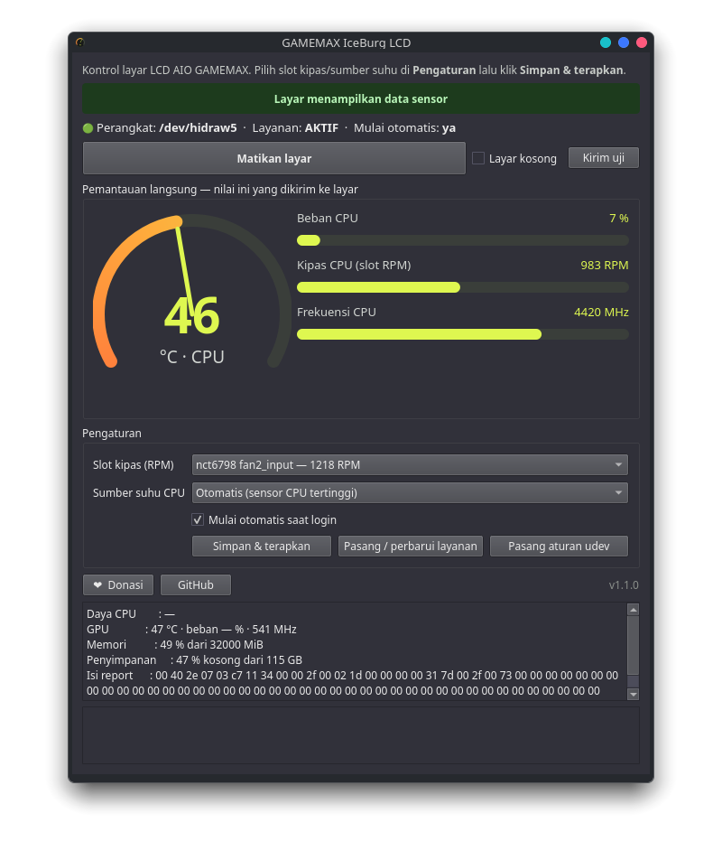
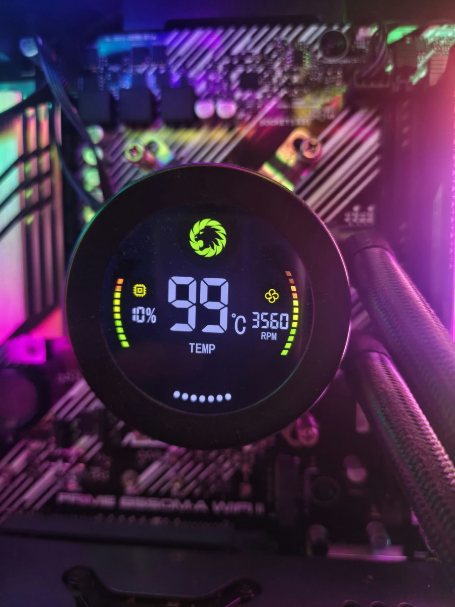
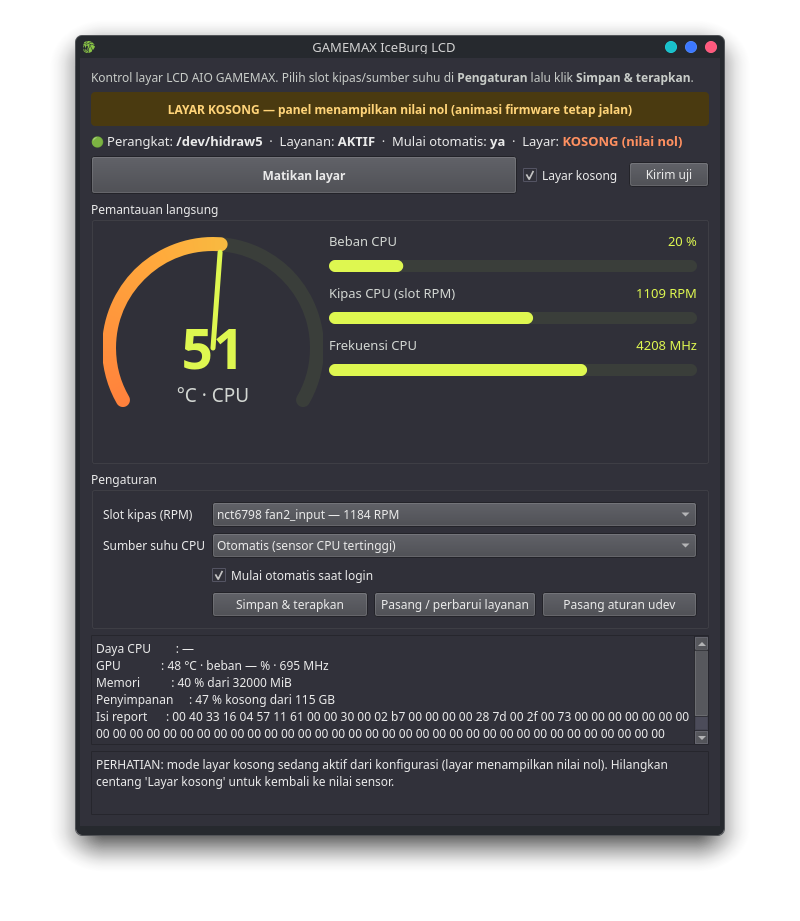

> 🪞 **Mirror.** Repo asli & pengembangan ada di **Gitea**: https://gitea.oxpoe.qzz.io/oxpoe/Gamemax-linux-apps

# GAMEMAX LCD — Linux bridge & tray app

Drive the LCD panel of a GAMEMAX **IceBurg Digital** AIO cooler from Linux: a small
sender plus a tray application (GUI) with live monitoring, settings and autostart.

Reverse engineered independently from the Windows vendor software
(`PcInfoMonitorPro.exe` / "IceBurg Digital Software"); the protocol notes are in
[`docs/reverse-engineering.md`](docs/reverse-engineering.md) (Indonesian).

[](https://github.com/oxpoe/Gamemax-linux-apps/releases)
[](https://github.com/oxpoe/Gamemax-linux-apps/actions/workflows/release.yml)
[](LICENSE)
[](#compatibility)
[](src/gamemax_report.py)
[](src/gamemax_report.py)
[](https://donasi.oxpoe.qzz.io/)

```text
 hwmon · /proc/stat · cpufreq · meminfo · statvfs
                    │
                    ▼
        gamemax_report.py  ──►  65-byte HID report  ──►  LCD panel
          (stdlib only)          hidraw, 5131:2007
                    ▲
        gamemax_gui.py (tray)  ──►  systemd user unit + udev rule
```

Author: **oxpoe** · License: **MIT** · Independent project, **not affiliated with the
vendor** — please read [DISCLAIMER.md](DISCLAIMER.md) before using it.

> **Compatibility**
> - **OS:** Linux only (Windows is handled by the vendor software). No kernel module,
>   no patched driver — it talks to the standard `hidraw` interface.
> - **Tested on:** CachyOS (Arch) · kernel 7.2.9 · KDE Plasma Wayland · Python 3.14,
>   with the panel of a **GAMEMAX IceBurg 240 Digital BK** (HID `5131:2007`,
>   vendor-defined usage page `0xFF00`, 64-byte reports).
> - Other IceBurg Digital models/sizes very likely share the same protocol; if a panel
>   revision differs, `gamemax_report.py --dry-run` lets you inspect the report without
>   writing to the device.
> - The panel keeps animating on its own; the firmware offers **no command to power the
>   display off** and **no way to change the logo** — blank mode simply sends zeros.



### On real hardware



*The cooler's LCD while driven by this project on Linux, during protocol testing
(GAMEMAX IceBurg 240 Digital BK).*

### Screen modes

| Normal — sensor values | Blank — zeros (indicator is clear) |
|---|---|
|  |  |

## Tested hardware

The target is the **LCD block of an AIO cooler**. Two things confuse people, so they are
stated up front:

1. `lsusb` shows this device as *"MSR MSR-101U Mini HID magnetic card reader"*. That is a
   **VID/PID collision in the `usb.ids` database** (the `0x5131` range is shared by cheap
   OEM modules), not what the device is. The HID report descriptor is vendor-defined
   (`0xFF00`, 64-byte input + 64-byte output, no report IDs) — a card reader or keyboard
   looks completely different. Check it yourself:

   ```bash
   cat /sys/class/hidraw/hidraw*/device/report_descriptor | xxd | head
   ```

2. The panel is not a general monitor. It belongs to one specific cooler family, and its
   firmware decides what it renders (two digits, fixed `°C` label, its own animations).

| Component | What it is / what it provides |
|---|---|
| Cooler + LCD panel | **GAMEMAX IceBurg 240 Digital BK** — 240 mm AIO, round 66×45 mm LCD block |
| Panel USB identity | `VID 0x5131` / `PID 0x2007` · USB 1.10 full-speed · 2 × 64-byte interrupt endpoints · `bInterval` 160 ms · no report IDs |
| Vendor software analysed | `PcInfoMonitorPro.exe` **V_1.0.0.04** ("IceBurg 240 Digital Software", [product page](https://gamemaxpc.com/cpu-liquid-cooler/1550.html)) |
| CPU (temperature source) | AMD Ryzen 5 5600 → `k10temp` (`Tctl`, `Tccd1`; the script sends the highest) |
| Motherboard (fan source) | ASUS PRIME B550M-A WIFI II → Nuvoton **`nct6798`** (`fan1..fan7`; only the connected headers read non-zero) |
| GPU | AMD Radeon RX 6600 (Navi 23) → `amdgpu` hwmon (temp, fan, power, busy %) |
| Memory / storage | 32 GB RAM · NVMe root filesystem |
| OS / session | CachyOS (Arch) · kernel 7.2.9 · KDE Plasma on Wayland |
| Tooling | Python 3.14.7 · PySide6 6.12.0 · hidraw (no kernel module, no driver patch) |

Because fan headers differ per board, the fan channel is a **setting**, not a constant:
the GUI lists every `fan*_input` channel with its current RPM and (if the chosen one reads
0 RPM while another spins) tells you which channel to pick. Same idea for the CPU
temperature source (Tctl vs Tccd).

## Features

- Sends CPU temp/load/clock/fan/power, GPU temp/load/clock/fan/power, RAM and disk
  usage to the panel as a 65-byte HID report (the layout the firmware understands)
- Reads sensors from standard Linux interfaces: `hwmon`, `/proc/stat`, `cpufreq`,
  `/proc/meminfo`, `statvfs` — no extra dependencies (pure Python, stdlib only)
- **Tray app** (`--tray-only`) plus a window with an animated gauge, bars and details
- **Settings**: fan channel (pick the header your fans are on), CPU temperature source,
  send/sample interval — saved to `~/.config/gamemax-report/config.json`
- **Clear mode indicators**: green "showing sensor data" / orange "blank (zeros)" /
  grey "sending stopped", dimmed tray icon and a desktop notification per change
- **Autostart** at login: a systemd user unit for the sender **and** an XDG autostart entry that
  starts the tray app with `--tray-only` (no window pops up; open it from the tray menu). The
  *Mulai otomatis saat login* checkbox manages both, and disables any other autostart entry that
  would launch the same AppImage with a window.
- **Plug and play**: the service waits for the device, streams while present and keeps
  waiting through unplug/replug; a udev rule grants access to the logged-in user
- **Single instance**: launching the app again just raises the running window
- **Self-update from GitHub Releases** (check + one-click update)
- **Donate / GitHub buttons** in the app (window and tray menu)
- **AppImage build** script (`packaging/build_appimage.sh`, PySide6 bundled)

The GUI labels are in Indonesian. The app itself is named **IceBurg LCD** (no vendor brand in
the UI); the repository keeps the hardware and brand name only to describe what it supports.

## Requirements

- A GAMEMAX IceBurg Digital panel connected over USB (VID `0x5131`, PID `0x2007`)
- `hidraw` access for your user (see the udev rule in *Install*)

- Linux with a working `hidraw` stack (tested on CachyOS / Arch, KDE Wayland)
- Python 3.10+ for the sender (stdlib only)
- For the tray app: PySide6 (`uv run --with pyside6 python src/gamemax_gui.py`)
  or use the prebuilt AppImage

## Install

One command (downloads the latest release, verifies its SHA-256, installs the app, the
systemd user unit, the menu entry and the udev rule):

```bash
curl -fsSL https://raw.githubusercontent.com/oxpoe/Gamemax-linux-apps/main/install.sh | bash
# uninstall:  bash install.sh --uninstall        (add --remove-data to drop settings too)
```

Manual steps, if you prefer to see every command:

```bash
# 1. device access for the logged-in user (once, needs root)
sudo cp packaging/70-gamemax.rules /etc/udev/rules.d/
sudo udevadm control --reload && sudo udevadm trigger --subsystem-match=hidraw

# 2. try it without installing anything
cd src
python3 gamemax_report.py --dry-run      # build and print a report, no device writes
python3 gamemax_report.py --listen 5     # read panel -> host reports (none on this panel)

# 3. send for real
python3 gamemax_report.py --count 3      # a few reports
python3 gamemax_report.py                # keep streaming (Ctrl-C to stop)
```

## Run as a background service (autostart + plug and play)

```bash
mkdir -p ~/.local/share/gamemax-report ~/.config/systemd/user
cp src/gamemax_report.py ~/.local/share/gamemax-report/
cp packaging/gamemax-report.service ~/.config/systemd/user/
systemctl --user daemon-reload
systemctl --user enable --now gamemax-report.service
journalctl --user -u gamemax-report -f        # shows "waiting for 0x5131:0x2007" / "opened ..."
```

The tray app can do all of this for you (buttons *Pasang / perbarui layanan*,
*Mulai otomatis saat login*).

## Tray app / AppImage

**Download (recommended):** grab `GAMEMAX-LCD-x86_64.AppImage` from
[Releases](../../releases) — it bundles PySide6, the sender script and the icon, and is
built automatically from source by `.github/workflows/release.yml`.

```bash
chmod +x GAMEMAX-LCD-x86_64.AppImage
./GAMEMAX-LCD-x86_64.AppImage --selftest     # verify it starts (no display needed)
./GAMEMAX-LCD-x86_64.AppImage                # window + tray

# or run from source
uv run --with pyside6 python src/gamemax_gui.py            # window + tray
uv run --with pyside6 python src/gamemax_gui.py --tray-only

bash packaging/build_appimage.sh                            # -> dist/GAMEMAX-LCD-x86_64.AppImage
```

## Protocol (verified on hardware)

VID `0x5131` / PID `0x2007`, vendor-defined HID page `0xFF00`, 64-byte IN + 64-byte OUT,
no report IDs. The host sends 64 data bytes:

| Offset | Field | Notes |
|---|---|---|
| 0 | report ID | always 0 |
| 1 | 64 | payload length |
| 2 | CPU temp | 0..99 °C, two digits only; values ≥ 128 are ignored by firmware |
| 3 | CPU load % | |
| 4..5 | RPM slot | big-endian u16 — the panel shows *this* field next to the fan icon |
| 6..7 | CPU clock MHz | big-endian u16 |
| 8..9 | CPU power W | big-endian u16 |
| 10 | GPU temp | 0..99 °C |
| 11 | GPU load % | |
| 12..13 | GPU clock MHz | big-endian u16 |
| 14..15 | GPU fan RPM | big-endian u16 |
| 16..17 | GPU power W | big-endian u16 |
| 18 | RAM usage % | |
| 19..20 | total RAM MiB | big-endian u16 |
| 21 | disk free % | |
| 22..23 | total disk GB | big-endian u16 |
| 24..64 | unused | zero |

Firmware behaviours worth knowing: the panel latches values it accepts, blinks the
value area when the data stops changing, cannot display three digits, has a fixed `°C`
label, and offers no command to power the display off.

## Repository layout

```
src/         gamemax_report.py (sender)  gamemax_gui.py (tray app)  icon.png
packaging/   build_appimage.sh  70-gamemax.rules  gamemax-report.service
tools/       ildump.py, string_refs.py — helpers used to read the vendor MSIL
docs/        reverse-engineering.md — full analysis (Indonesian)
assets/      previews and icon
```

## Updates

The app keeps itself current from GitHub Releases:

- On start (when running from an AppImage) and from the **Periksa pembaruan** button or the
  tray menu, it asks the GitHub API for the latest release and compares it with its version.
- When a newer release exists, a **Perbarui ke vX.Y.Z** button appears. One click downloads
  the release asset, replaces the running AppImage atomically, refreshes the sender from the
  new bundle and restarts the service. Restart the app to use the new version.
- The download is verified against the release's published **SHA-256** before the AppImage is
  replaced; a mismatch aborts the update. Older releases without a checksum are updated with a
  warning in the log.
- Nothing is downloaded without that click, and no other files are touched.

Each release publishes three assets: the AppImage, its `.sha256`, and a `.zsync` file for
`appimageupdatetool` / AppImageUpdate (delta updates). The zsync file is optional — the
built-in updater does not need it — but the AppImage also carries the zsync URL as embedded
update information (releases built after v1.2.3), so `appimageupdatetool ./GAMEMAX-LCD.AppImage`
works directly.

If the check fails (offline, proxy), the message appears in the app log. `GAMEMAX_DEBUG=1`
also mirrors the log to stdout for headless runs.

## Support

If this project is useful to you:

- ❤ **Donate:** <https://donasi.oxpoe.qzz.io/> (buttons for it and for this repository are
  in the app: window bottom row and the tray menu)
- ⭐ Star the repo, or open an issue with your cooler model and what worked — reports from
  other IceBurg Digital revisions are the best way to widen hardware support.

## Credits

Reverse engineered and written by **oxpoe**, with the help of
[REA](https://github.com/morluto/rea) (managed-code analysis) and Ghidra.
Not affiliated with GAMEMAX/GameMax — see [DISCLAIMER.md](DISCLAIMER.md).
